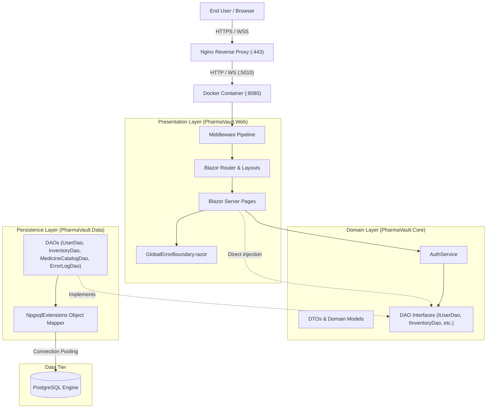
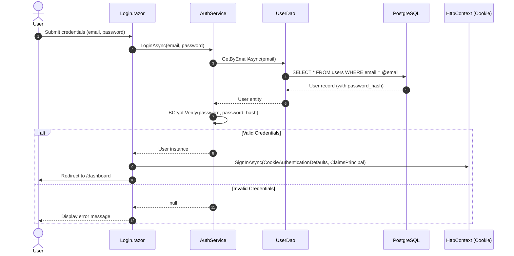
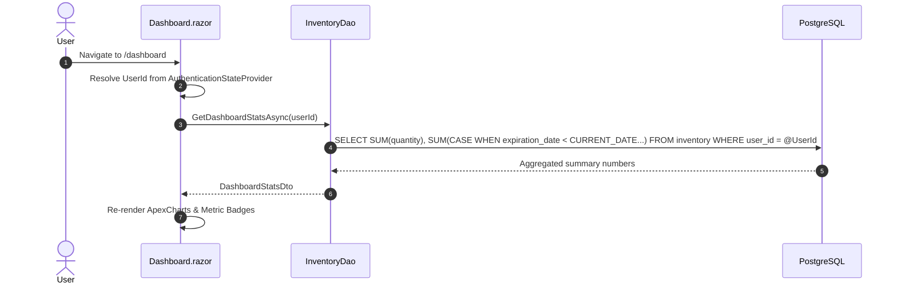

# 🏛️ PharmaVault - Software Architecture Document

---

## 1. Executive Summary

**PharmaVault** is a modern, web-based personal and family medication inventory management platform. It addresses the common and costly challenges of expired pharmaceutical disposal, health hazards from taking outdated drugs, and unnecessary duplicate purchases. 

The application offers an interactive, zero-latency dashboard where users track the health of their medication inventory in real-time (categorized into *Good Condition*, *Expiring Soon*, and *Expired*), manage a centralized pharmaceutical catalog with dosage and administration forms, and maintain private, authenticated personal medicine stocks.

PharmaVault is built using a clean, three-tier architecture in **.NET 10 (C# 13)**, utilizing **Blazor Interactive Server** for reactive SignalR-driven UI flows, direct **PostgreSQL** persistence via high-throughput ADO.NET DAOs, and a production deployment pattern featuring containerization via **Docker** and reverse-proxy termination via **Nginx**.

---

## 2. Tech Stack

| Layer / Domain | Technology | Version | Purpose & Architectural Rationale |
| :--- | :--- | :--- | :--- |
| **Platform / Runtime** | [.NET](https://dotnet.microsoft.com/) | 10.0 (`net10.0`) | Unified runtime with top-tier performance, thread-pool optimization, and modern C# 13 syntax. |
| **Presentation Tier** | [Blazor Web App](https://dotnet.microsoft.com/apps/aspnet/web-apps/blazor) | Interactive Server (SignalR) | Real-time state synchronization over WebSockets; eliminates client/server API contract drift by sharing domain models across tiers. |
| **UI Framework & Icons**| [Bootstrap](https://getbootstrap.com/) & Icons | 5.x / 1.11.3 | Responsive, mobile-first design grid, floating form labels, and standard UI primitives. |
| **Data Visualization** | [Blazor-ApexCharts](https://apexcharts.github.io/Blazor-ApexCharts/) | Compatible v4 | Real-time reactive donut charts visualizing inventory health metrics. |
| **Authentication** | ASP.NET Core Cookie Auth | Built-in | Stateful cookie-based authentication (`PharmaVaultSession`) with cascading authentication state. |
| **Security / Crypto** | [BCrypt.Net-Next](https://github.com/BcryptNet/bcrypt.net) | 4.x | Cryptographic one-way password hashing with automatic salting to resist rainbow table attacks. |
| **Persistence Driver** | [Npgsql](https://www.npgsql.org/) | Modern ADO.NET | Low-level, high-speed PostgreSQL driver using raw SQL commands to bypass heavy ORM overhead. |
| **Object Mapping** | Custom ADO.NET Extension | In-house | Reflection-based `DbDataReader` mapping extension (`NpgsqlExtensions`) for light DTO instantiation. |
| **Database Engine** | [PostgreSQL](https://www.postgresql.org/) | 16+ | ACID-compliant relational engine with native date arithmetic and UUID generators (`gen_random_uuid()`). |
| **Container & Proxy** | Docker & Nginx | Multi-stage / Alpine | Docker isolation with multi-stage compilation; Nginx handles TLS termination and WebSocket protocol switching. |

---

## 3. System Architecture

### 3.1 Architectural Pattern
PharmaVault implements a **Three-Tier Clean Architecture / Separation of Concerns (SoC)** model divided across three solution projects:

1. **`PharmaVault.Core` (Domain & Abstractions):**
   - **Entities & Models:** `User`, `MedicineCatalog`, `Inventory`, `ErrorLog`, `SystemResponse`.
   - **DTOs:** `InventoryItemDto`, `DashboardStatsDto`, `ExceptionLogDto`.
   - **Interfaces:** `IUserDao`, `IMedicineCatalogDao`, `IInventoryDao`, `IErrorLogDao`, `IAuthService`.
   - **Services:** `AuthService` (handles password hashing and validation).
   - Zero dependencies on database or web libraries.

2. **`PharmaVault.Data` (Infrastructure & Persistence):**
   - Implements data access interfaces via the **Data Access Object (DAO)** pattern.
   - Executes parameterized SQL statements against PostgreSQL.
   - Provides reflection mapper extensions via `NpgsqlExtensions`.

3. **`PharmaVault.Web` (Presentation & Pipeline):**
   - Hosts Blazor components (`Dashboard`, `Inventory`, `Medicines`, `Login`, `Register`).
   - Manages HTTP middleware (`ExceptionHandlingMiddleware`), cookie authentication, routing, and UI error boundaries (`GlobalErrorBoundary`).

### 3.2 Key Data & Interaction Workflows

#### Authentication Flow

#### Inventory Management & Analytics Flow

---

## 4. Improvement Proposals

The following prioritized roadmap outlines key architectural, security, and performance optimizations identified for the application:

### Prioritized Opportunity Matrix

| ID | Domain | Recommendation | Priority | Effort | Impact |
| :--- | :--- | :--- | :---: | :---: | :---: |
| **IMP-01** | **Security** | Implement `<AuthorizeRouteView>` in Router | **High** | Low | High |
| **IMP-02** | **Security / Multitenancy** | Restrict Master Catalog Mutations (RBAC / User Scoping) | **High** | Medium | High |
| **IMP-03** | **Performance** | Replace Raw Reflection Mapping with Dapper / Compiled Source Generators | **High** | Medium | High |
| **IMP-04** | **Architecture** | Introduce Application Services between Web & Data | **Medium** | Medium | High |
| **IMP-05** | **Database** | Add Missing Relational Indexes & Adopt `NpgsqlDataSource` | **Medium** | Low | High |
| **IMP-06** | **Reliability** | Decouple UI Exception Logging via Background Channel | **Medium** | Low | Medium |
| **IMP-07** | **DevOps** | Container Hardening (Non-Root User) & Health Checks | **Low** | Low | Medium |

### Detailed Actions

1. **IMP-01 - Blazor Route Authorization Guarding:**
   Replace `<RouteView>` with `<AuthorizeRouteView>` in `Routes.razor`. Although `@attribute [Authorize]` is applied to pages, interactive SignalR transitions bypass standard HTTP middleware checks without router-level authorization guards.
2. **IMP-02 - Multi-tenant Master Catalog Isolation:**
   Currently, any authenticated user can edit or disable medicines globally in `medicine_catalog`. Add an `is_system` flag or `user_id` owner column to ensure users can manage their custom medicines without mutating global records.
3. **IMP-03 - High-Throughput Object Mapping:**
   `NpgsqlExtensions` invokes `typeof(T).GetProperties()` and dynamic `SetValue` reflection for every row without caching. Migrating to [Dapper](https://github.com/DapperLib/Dapper) will deliver compiled IL delegates, eliminate reflection overhead, and handle type mapping safely.
4. **IMP-04 - Business Service Layer:**
   Encapsulate business validation (e.g. stock cannot be negative, expiration dates cannot be older than purchase dates) inside service classes (`InventoryService`, `CatalogService`) rather than injecting DAOs directly into Razor components.
5. **IMP-05 - Relational Indexing & Modern Connection Pooling:**
   Add indexes on `inventory(user_id, expiration_date)` and `error_logs(incident_number)`. Switch connection instantiation to `NpgsqlDataSource` in `Program.cs` to leverage modern connection pooling and telemetry.
6. **IMP-06 - Decoupled Error Logging:**
   In `GlobalErrorBoundary.razor.cs`, exceptions make unawaited asynchronous database calls on the SignalR thread. Route error logs through an in-memory `System.Threading.Channels.Channel` consumed by a `BackgroundService` to prevent database latency from stalling the UI circuit.
7. **IMP-07 - Container Security & Observability:**
   Configure `USER $APP_UID` in the final Dockerfile stage to adhere to the principle of least privilege, and register `/healthz` endpoints for automated uptime monitoring via Nginx and Docker.

---

## 5. Conclusion

PharmaVault provides a well-structured and functional solution for home medication management. Its core strengths include:
- Clean modularity between domain contracts and persistence details.
- High-efficiency server-side data bucketing for expiration metrics.
- Comprehensive end-to-end incident logging featuring user-visible UUID tracking.

Executing the prioritized improvements above will reinforce the application's multi-user isolation, boost database query efficiency, and deliver an enterprise-ready posture.
