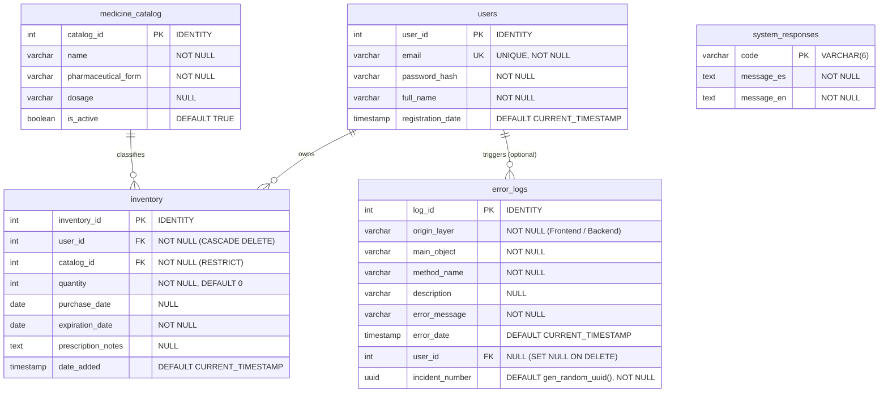

# 🗄️ PharmaVault - Database Dictionary

---

## 1. Overview & Entity-Relationship Model

The **PharmaVault** database (`pharmavault_db`) is hosted on **PostgreSQL**. It models user identity, a standardized pharmaceutical master catalog, user-specific medicine stock inventory, bilingual response codes, and centralized incident error auditing.

### 1.1 Entity-Relationship Diagram (ERD)



---

## 2. Table Specifications

### 2.1 Table: `users`
Represents registered application accounts. Authenticates users and isolates inventory ownership.

| Column | Data Type | Nullable | Default | Constraints | Description |
| :--- | :--- | :---: | :--- | :--- | :--- |
| `user_id` | `INT` | No | `GENERATED ALWAYS AS IDENTITY` | `PRIMARY KEY` | Unique surrogate identifier for the user account. |
| `email` | `VARCHAR(255)` | No | *None* | `UNIQUE` | User's unique electronic mail address used for authentication. |
| `password_hash` | `VARCHAR(255)` | No | *None* | *None* | Salted BCrypt cryptographic hash of the user password. |
| `full_name` | `VARCHAR(100)` | No | *None* | *None* | User's display name, rendered across the application header/dashboard. |
| `registration_date` | `TIMESTAMP` | Yes | `CURRENT_TIMESTAMP` | *None* | UTC timestamp of account creation. |

---

### 2.2 Table: `medicine_catalog`
Centralized pharmaceutical master catalog describing commercially available medications, pharmaceutical forms, and concentrations.

| Column | Data Type | Nullable | Default | Constraints | Description |
| :--- | :--- | :---: | :--- | :--- | :--- |
| `catalog_id` | `INT` | No | `GENERATED ALWAYS AS IDENTITY` | `PRIMARY KEY` | Unique surrogate identifier for the catalog entry. |
| `name` | `VARCHAR(250)` | No | *None* | *None* | Commercial or generic name of the drug (e.g., *Paracetamol*, *Ibuprofen*). |
| `pharmaceutical_form` | `VARCHAR(50)` | No | *None* | *None* | Physical delivery format (e.g., *Tablet*, *Capsule*, *Syrup*, *Ointment*, *Drops*). |
| `dosage` | `VARCHAR(50)` | Yes | `NULL` | *None* | Concentration or strength per unit (e.g., *500mg*, *10mg/ml*). |
| `is_active` | `BOOLEAN` | Yes | `TRUE` | *None* | Logical flag enabling soft-disabling without breaking existing inventory foreign keys. |

---

### 2.3 Table: `inventory`
Represents physical batches or packages of medications owned by a specific user.

| Column | Data Type | Nullable | Default | Constraints | Description |
| :--- | :--- | :---: | :--- | :--- | :--- |
| `inventory_id` | `INT` | No | `GENERATED ALWAYS AS IDENTITY` | `PRIMARY KEY` | Unique surrogate identifier for the specific stock batch. |
| `user_id` | `INT` | No | *None* | `FOREIGN KEY (users.user_id) ON DELETE CASCADE` | References the user who owns this inventory item. |
| `catalog_id` | `INT` | No | *None* | `FOREIGN KEY (medicine_catalog.catalog_id)` | References the master catalog drug definition. |
| `quantity` | `INT` | No | `0` | `DEFAULT 0` | Available unit count (e.g., pills, bottles, boxes). |
| `purchase_date` | `DATE` | Yes | `NULL` | *None* | Date when the item was purchased or obtained. |
| `expiration_date` | `DATE` | No | *None* | *None* | Expiry date printed on the packaging. Used for dashboard alerts and status calculations. |
| `prescription_notes` | `TEXT` | Yes | `NULL` | *None* | Optional instructions, dosage frequency, or doctor notes. |
| `date_added` | `TIMESTAMP` | Yes | `CURRENT_TIMESTAMP` | *None* | Timestamp when this item was logged into the system. |

---

### 2.4 Table: `error_logs`
Centralized application audit log for both client-side (Blazor SignalR) and server-side (HTTP middleware) unhandled or controlled exceptions.

| Column | Data Type | Nullable | Default | Constraints | Description |
| :--- | :--- | :---: | :--- | :--- | :--- |
| `log_id` | `INT` | No | `GENERATED ALWAYS AS IDENTITY` | `PRIMARY KEY` | Sequential surrogate identifier for the log entry. |
| `origin_layer` | `VARCHAR(15)` | No | *None* | *None* | Architectural layer where fault originated (`Frontend` or `Backend`). |
| `main_object` | `VARCHAR(50)` | No | *None* | *None* | Class, Component, or Controller name where the error was thrown. |
| `method_name` | `VARCHAR(50)` | No | *None* | *None* | Specific method or lifecycle hook where failure occurred. |
| `description` | `VARCHAR(4000)`| Yes | `NULL` | *None* | Detailed stack trace or contextual payload. Truncated to 3,900 chars safely. |
| `error_message` | `VARCHAR(4000)`| No | *None* | *None* | Exception message string. |
| `error_date` | `TIMESTAMP` | Yes | `CURRENT_TIMESTAMP` | *None* | Timestamp when the error was registered. |
| `user_id` | `INT` | Yes | `NULL` | `FOREIGN KEY (users.user_id) ON DELETE SET NULL` | Authenticated user active when the exception triggered, or `NULL` if anonymous. |
| `incident_number` | `UUID` | No | `gen_random_uuid()` | *None* | Globally unique correlation ID displayed to the end-user and logged to console. |

---

### 2.5 Table: `system_responses`
Standardized bilingual lookup table for standardized system return codes and localized error messages.

| Column | Data Type | Nullable | Default | Constraints | Description |
| :--- | :--- | :---: | :--- | :--- | :--- |
| `code` | `VARCHAR(6)` | No | *None* | `PRIMARY KEY` | Standard error/status code identifier (e.g., `AUTH01`, `INV002`). |
| `message_es` | `TEXT` | No | *None* | *None* | Spanish localized error description. |
| `message_en` | `TEXT` | No | *None* | *None* | English localized error description. |

---

## 3. Database Constraints & Relationships Summary

| Source Table | Source Column | Target Table | Target Column | On Delete Action | Business Rationale |
| :--- | :--- | :--- | :--- | :--- | :--- |
| `inventory` | `user_id` | `users` | `user_id` | `CASCADE` | When a user account is deleted, their private medication inventory is purged. |
| `inventory` | `catalog_id` | `medicine_catalog` | `catalog_id` | `NO ACTION / RESTRICT` | Prevents accidental deletion of catalog items currently referenced by active user stock. |
| `error_logs` | `user_id` | `users` | `user_id` | `SET NULL` | Preserves error diagnostic history even if the affected user account is subsequently removed. |

---

## 4. Indexing & Optimization Recommendations

The initial database script creates primary keys and unique constraints (which automatically receive B-tree indexes), but omits foreign key and filter indexes. The following indexes are recommended for performance:

```sql
-- 1. Accelerates dashboard aggregation and user inventory loading
CREATE INDEX idx_inventory_user_id 
    ON inventory(user_id);

-- 2. Composite index optimizing expiration date calculations per user
CREATE INDEX idx_inventory_user_expiration 
    ON inventory(user_id, expiration_date ASC);

-- 3. Accelerates joins between inventory and master catalog
CREATE INDEX idx_inventory_catalog_id 
    ON inventory(catalog_id);

-- 4. Enables immediate lookup of incident reports by UUID
CREATE UNIQUE INDEX idx_error_logs_incident_number 
    ON error_logs(incident_number);

-- 5. Enables audit query filtering by date
CREATE INDEX idx_error_logs_error_date 
    ON error_logs(error_date DESC);
```
